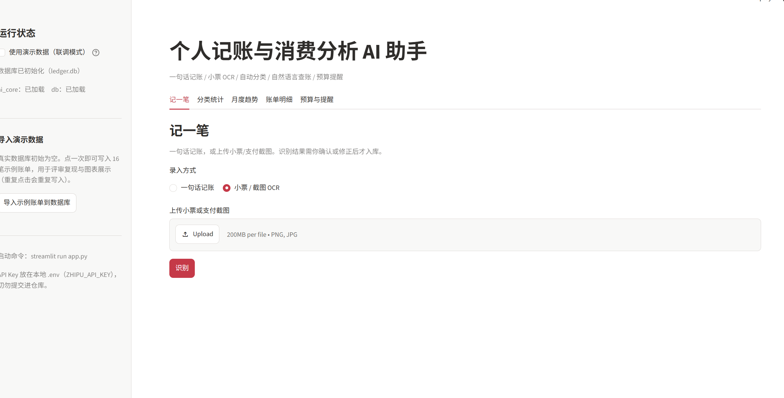
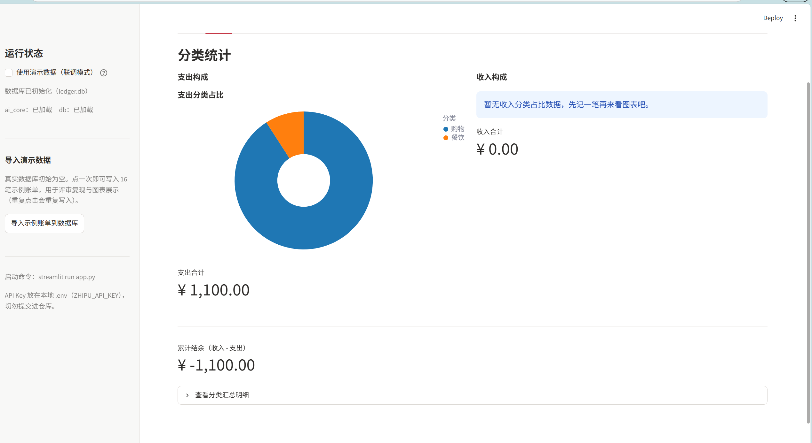
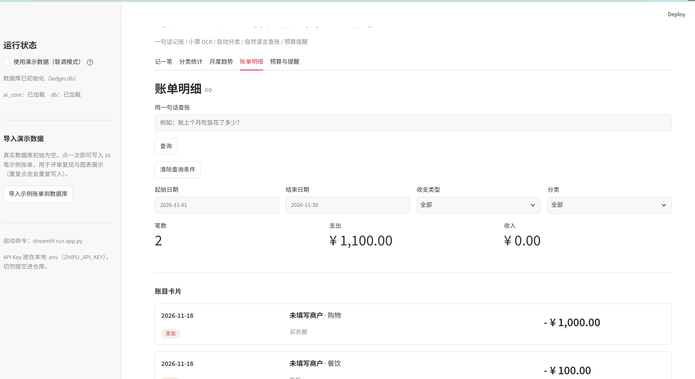
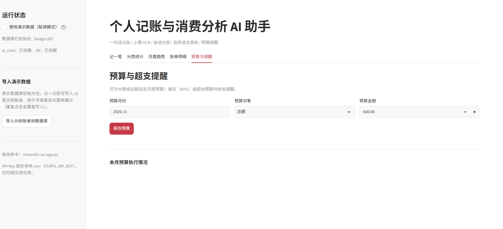

# 个人记账与消费分析 AI 助手

说一句话、或拍一张小票，AI 帮你记成一笔账；金额、分类、日期都能改，统计图与预算提醒自动算。

这个项目要解决的唯一问题：**记账这件事太麻烦，所以没人坚持**。所以它不追求"一步到位"，而是把"AI 猜的"变成"你确认的"——所有识别结果都是草稿，关键字段必须人工过目。

## 界面

| 记一笔 | 分类统计 |
|---|---|
|  |  |

| 账单明细 | 预算与提醒 |
|---|---|
|  |  |

## 目录结构

```
AI_Tutor_Project/
├─ app.py            界面：五个页签、草稿卡片、图表、预算         （佳欣）
├─ ai_core.py        调文本模型与视觉模型，统一返回 {ok, data, msg}（赵君如）
├─ prompts.py        三套提示词、七类分类、拒答规则、JSON 清洗      （汝晴）
├─ db.py             SQLite 三张表 + 统计 + 预算 + 原子重置         （文勤）
├─ docs/             接口约定、项目文档、界面截图
├─ tests/            提示词单元测试（75 个）
├─ tools/            提示词调试与流程脚本
├─ assets/uploads/   上传的小票（本地生成，不进仓库）
├─ requirements.txt
├─ 启动.cmd           双击启动（Windows）
└─ README.md
```

## 环境搭建与运行

1. 安装依赖

   ```
   pip install -r requirements.txt
   ```

2. 配置密钥

   ```
   copy .env.example .env
   ```

   用记事本打开 `.env`，把 `ZHIPU_API_KEY=` 后面填上自己的 Key（智谱开放平台注册即可）。

3. 启动

   - Windows：双击 `启动.cmd`
   - 命令行：`python -m streamlit run app.py`

4. 打开浏览器访问 `http://localhost:8501`

5. 首次打开是空库，点侧边栏 **「重置演示数据（清空后写入 16 笔）」** 载入示例账单

> 没有 `.env` 也能启动：侧边栏会显示「ai_core：未就绪」，界面自动进入演示数据模式，五个页签照样能点，只是识别功能不可用。

## 功能清单与验证方式

| 功能 | 怎么验证 |
|---|---|
| 一句话记账 | 输入「昨天打车 32」→ 卡片自动填好 交通 / 32 / 昨天日期 |
| 小票 / 截图识别 | 上传一张小票 → 金额、商户、日期、分类自动填入 |
| 收支区分 | 输入「发工资 8000」→ 收支类型自动为「收入」 |
| 结果可修正 | 改卡片上任意字段 → 确认 → 明细里就是改后的值 |
| 自然语言查账 | 明细页输入「上个月吃饭花了多少」 |
| 分类统计 / 月度趋势 | 切换页签，图表合计与明细逐笔相加一致 |
| 预算与超支提醒 | 设预算 600，支出超过后出现红色提示 |
| 演示数据一键重置 | 连点 3 次「重置演示数据」，账本恒为 16 笔 |
| AI 调用留痕 | 明细页底部「AI 调用记录」面板，显示最近 10 次的原话与模型返回 |

## 测试

```
python run_tests.py
```

75 个提示词单元测试，覆盖时间上下文、金额抽取、类别归一、拒答、JSON 容错。

## 已知问题与未完成部分

- **金额以 REAL（元）存储**，未采用接口约定中的整数「分」。所有金额聚合在 SQL 侧完成、展示层统一保留两位小数；切换到整数分需要同步改动统计数据与图表，在功能冻结前改动风险大于收益。
- **`evidence`（原文依据）尚未入库**：模型已能返回置信度，但"读到的是哪句话"还没有落到表里，正在本轮优化中补齐。
- **无多用户与登录**：个人记账是单用户场景；Streamlit 没有真正的会话隔离，硬做出来是"假的多用户"，因此明确不做。
- **未提供公网 Demo**：公网部署会暴露 API Key 与本地账本，风险大于收益。交付形式为本地一键启动 + 镜像。
- **上传未限制大小**：Streamlit 默认上限 200MB，建议单张图片控制在 5MB 以内。
- **真实纸质小票样本不足**：当前测试样本以清晰的示意图为主，热敏小票的折痕、反光、褪色会降低识别率；界面保留了「可修正」环节作为兜底。
